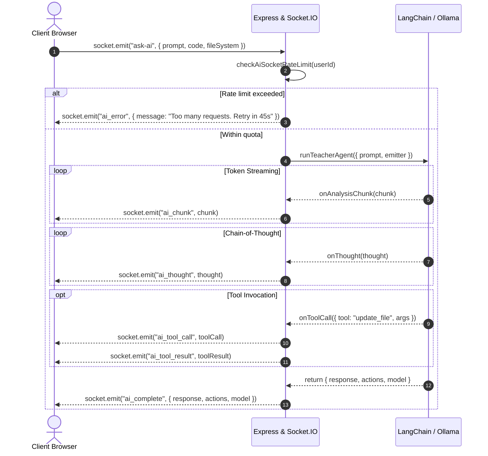

# Personal Code Editor

A self-hosted, cloud-native web code editor and execution platform featuring **Monaco Editor**, real-time **AI pair-programming agents** (via LangChain and Ollama/Gemini/OpenAI), an isolated **cgroup v2 & Bubblewrap sandboxed execution engine**, and secure multi-project workspace management.

---

## Table of Contents

- [Personal Code Editor](#personal-code-editor)
  - [Table of Contents](#table-of-contents)
  - [Architectural Overview](#architectural-overview)
  - [Key Features](#key-features)
  - [Security \& Authentication Architecture](#security--authentication-architecture)
    - [JWT Token Authentication](#jwt-token-authentication)
    - [WebSocket Authentication Handshake](#websocket-authentication-handshake)
    - [Password Security](#password-security)
    - [Origin Lockdown \& Sandbox Isolation](#origin-lockdown--sandbox-isolation)
  - [Rate Limiting Subsystem](#rate-limiting-subsystem)
  - [REST API Specification](#rest-api-specification)
    - [Authentication Endpoints](#authentication-endpoints)
      - [1. User Registration](#1-user-registration)
      - [2. User Authentication (Login)](#2-user-authentication-login)
      - [3. User Logout](#3-user-logout)
    - [Workspace \& Project Management](#workspace--project-management)
      - [1. Save Workspace Project](#1-save-workspace-project)
      - [2. Retrieve Project Workspace](#2-retrieve-project-workspace)
      - [3. Rename Project](#3-rename-project)
      - [4. Delete Project](#4-delete-project)
    - [Code Execution API](#code-execution-api)
    - [AI Assistant HTTP API](#ai-assistant-http-api)
      - [List Available AI Models](#list-available-ai-models)
    - [Live HTML Sandbox Preview](#live-html-sandbox-preview)
      - [1. Register Preview Content](#1-register-preview-content)
      - [2. Render Sandboxed Document](#2-render-sandboxed-document)
  - [WebSocket (Socket.IO) Streaming Protocol](#websocket-socketio-streaming-protocol)
    - [Client Message: `ask-ai`](#client-message-ask-ai)
    - [Server Events Emitted During Execution](#server-events-emitted-during-execution)
  - [Code Execution Engine (Codebox Integration)](#code-execution-engine-codebox-integration)
    - [Supported Runtimes \& Language IDs](#supported-runtimes--language-ids)
    - [Execution Workflow](#execution-workflow)
  - [Environment Configuration](#environment-configuration)
  - [Deployment \& Getting Started](#deployment--getting-started)
    - [Prerequisites](#prerequisites)
    - [Local Development Setup](#local-development-setup)
    - [Docker Stack Deployment](#docker-stack-deployment)
    - [Production Security Checklist](#production-security-checklist)

---

## Architectural Overview

```text
                           ┌──────────────────────────────────────────────┐
                           │          Client Web Browser (SPA/EJS)        │
                           │   - Monaco Editor Engine (VS Code core)     │
                           │   - Real-time Terminal & Execution Screen    │
                           │   - Virtual File Tree & Tab State Manager    │
                           │   - Sandboxed Opaque Origin HTML Preview     │
                           └──────────────────────┬───────────────────────┘
                                                  │
                 ┌────────────────────────────────┴───────────────────────────────┐
                 │ HTTP (REST API + Rate Limiter)  │ WebSocket (Socket.IO + Auth)  │
                 ▼                                 ▼                               ▼
┌────────────────────────────────────────────────────────────────────────────────────────┐
│                               Express.js Application Server                             │
│                                                                                        │
│  ┌───────────────────────┐  ┌─────────────────────────┐  ┌───────────────────────────┐  │
│  │   Auth Middleware     │  │   Rate Limiter Guard    │  │     Security Headers      │  │
│  │   - JWT Cookie/Bearer │  │   - Auth: 10/15m (IP)   │  │   - CSP & Permissions     │  │
│  │   - bcrypt Hash (x12) │  │   - Exec: 20/m (User/IP)│  │   - Opaque Sandbox Origin │  │
│  │   - Socket Handshake  │  │   - AI: 20/m (User/IP)  │  │   - Path Traversal Guard  │  │
│  └───────────────────────┘  └─────────────────────────┘  └───────────────────────────┘  │
│                                                                                        │
│  ┌───────────────────────┐  ┌─────────────────────────┐  ┌───────────────────────────┐  │
│  │   Workspace Manager   │  │   LangChain AI Agent    │  │    Execution Dispatcher   │  │
│  │   - Per-User Storage  │  │   - Tool Calling Engine │  │    - Codebox REST Client   │  │
│  │   - Project Export/ZIP│  │   - Ollama Cloud/Local  │  │    - Job Polling & Timeouts│  │
│  │   - File Upload Guard │  │   - Streaming Emitter   │  │    - Auth Header Injection │  │
│  └───────────────────────┘  └─────────────────────────┘  └───────────────────────────┘  │
└────────────────┬────────────────────────┬───────────────────────────────┬──────────────┘
                 │                        │                               │
                 ▼                        ▼                               ▼
  ┌─────────────────────────┐  ┌────────────────────┐   ┌────────────────────────────────┐
  │      MongoDB Atlas      │  │ Ollama AI Endpoint │   │  Codebox Sandboxed Engine      │
  │  - User Accounts        │  │  - Local (11434)   │   │  - Bubblewrap 0.12.0 Container │
  │  - Projects & Metadata  │  │  - Ollama Cloud    │   │  - Linux cgroup v2 Controllers │
  │  - Attached Documents   │  │  - Tool Automation │   │  - Seccomp-BPF & prlimit Guard │
  └─────────────────────────┘  └────────────────────┘   └────────────────────────────────┘
```

---

## Key Features

- **Monaco Editor Core**: Full-featured code editor with syntax highlighting, line numbers, bracket matching, tab management, and auto-indentation.
- **Sandboxed Execution (Codebox)**: Multi-language code execution inside hardened Bubblewrap namespaces isolated via Linux cgroup v2, Seccomp-BPF filters, and `prlimit` bounds.
- **AI Teacher Assistant**: Integrated LangChain agent supporting local Ollama (`localhost:11434`) and Cloud Ollama models. Streams token chunks, thoughts, and workspace tool calls (creating, updating, and inspecting files) over WebSockets.
- **Secure File Tree**: Virtual file system with recursive tree rendering, file renaming, creation, deletion, multi-tab switching, and debounced auto-save.
- **Live HTML/JS Preview**: Isolated sandbox runtime for testing HTML, CSS, and client-side JavaScript within an opaque CSP origin.
- **Zero-Trust Hardened**: Strict rate limiters, anti-traversal path resolution, per-user file storage boundaries, and origin-authenticated execution engine communication.

---

## Security & Authentication Architecture

### JWT Token Authentication

Authentication is token-driven and supports both standard browser interactions and headless HTTP API clients:

1. **Token Generation**: On successful authentication (`POST /login` or `POST /register`), a signed JSON Web Token (JWT) is issued with a 7-day expiration containing `{ userId, username, email }`.
2. **Client Storage**:
   - Browser clients receive the token via an `httpOnly`, `sameSite: "lax"` cookie named `token`.
   - Programmatic API requests can provide the token via the `Authorization: Bearer <token>` header.
3. **Verification**:
   - `requireAuth`: Enforces valid credentials for page views (e.g. `/editor`, `/DashboardCodeEditor`). Redirects unauthenticated traffic to `/login`.
   - `requireApiAuth`: Protects JSON REST endpoints (e.g. `/runCode`, `/save-project`). Emits `401 Unauthorized` JSON responses on missing or invalid tokens.

### WebSocket Authentication Handshake

Real-time Socket.IO connections are strictly authenticated at connection time using connection middleware:

```javascript
io.use((socket, next) => {
    const rawCookie = socket.handshake.headers.cookie;
    // Parses and verifies JWT signature against process.env.JWT_SECRET
    // Populates socket.user before granting access to event listeners
});
```

Unauthenticated WebSocket attempts fail closed prior to establishing an open connection.

### Password Security

- User passwords are automatically salted and hashed using **bcryptjs** with an enterprise cost factor of `12` rounds.
- Raw password inputs are strictly length-bounded (minimum 8 characters, maximum 128 characters) to mitigate algorithmic complexity Denial-of-Service attacks.

### Origin Lockdown & Sandbox Isolation

- **Engine Origin Verification**: The code execution backend (`CODE_EXECUTION_BOX`) rejects any browser traffic not originating from the configured `PUBLIC_URL` using origin and referer inspection middleware.
- **Same-Origin HTML Previews**: The `/preview/:id` endpoint isolates untrusted user HTML by enforcing:
  ```http
  Content-Security-Policy: default-src 'none'; script-src 'unsafe-inline'; style-src 'unsafe-inline'; sandbox allow-scripts allow-forms;
  ```
  This strips cookies, local storage, and ambient session credentials from the execution sandbox.
- **Storage Directory Isolation**: Per-user workspaces are strictly bound using canonical path containment checks, preventing directory traversal attacks (`../`).

---

## Rate Limiting Subsystem

To protect compute, database, and LLM quotas, all critical entrypoints are governed by configurable sliding-window rate limiters via `express-rate-limit`:

| Target Route / Action | Identifier Key | Limit Window | Max Requests | HTTP Status | Handler Action |
|---|---|---|---|---|---|
| `POST /login` | Client IP | 15 minutes | 10 | `429 Too Many Requests` | Renders login view with delay notice |
| `POST /register` | Client IP | 2 hours | 5 | `429 Too Many Requests` | Renders register view with lockout notice |
| `POST /runCode` | Authenticated `userId` (or IP) | 1 minute | 20 | `429 Too Many Requests` | Returns structured JSON status `"Rate Limited"` |
| `POST /ask-ai` | Authenticated `userId` (or IP) | 1 minute | 20 | `429 Too Many Requests` | Returns JSON error & clears actions |
| `socket.emit('ask-ai')` | Authenticated `userId` (or Socket ID) | 1 minute | 20 | Socket Event | Emits `ai_error` with remaining retry seconds |

*IPv6 addresses are normalized through `ipKeyGenerator` to prevent subnet spoofing.*

---

## REST API Specification

### Authentication Endpoints

#### 1. User Registration
Registers a new user account.

- **URL**: `/register`
- **Method**: `POST`
- **Headers**: `Content-Type: application/json` or `application/x-www-form-urlencoded`
- **Rate Limit**: 5 attempts / 2 hours per IP

**Request Body**:
```json
{
  "username": "developer1",
  "email": "developer1@example.com",
  "password": "SecurePassword123!",
  "confirmPassword": "SecurePassword123!"
}
```

**Response (`201 Created` / JSON Client)**:
```json
{
  "success": true,
  "message": "Account created successfully.",
  "redirectUrl": "/login?registered=true&email=developer1%40example.com"
}
```

#### 2. User Authentication (Login)
Authenticates credentials and establishes a 7-day session.

- **URL**: `/login`
- **Method**: `POST`
- **Headers**: `Content-Type: application/json` or `application/x-www-form-urlencoded`
- **Rate Limit**: 10 attempts / 15 minutes per IP

**Request Body**:
```json
{
  "email": "developer1@example.com",
  "password": "SecurePassword123!"
}
```

**Response (`302 Found` / Browser)**:
- Redirects to `/DashboardCodeEditor` with `Set-Cookie: token=<jwt>; HttpOnly; Path=/; SameSite=Lax`.

#### 3. User Logout
Invalidates the client session cookie.

- **URL**: `/logout`
- **Method**: `GET` | `POST`
- **Response**: Clears `token` cookie and redirects to `/login`.

---

### Workspace & Project Management

#### 1. Save Workspace Project
Persists workspace files, open tabs, active language, and serialized code to MongoDB.

- **URL**: `/save-project`
- **Method**: `POST`
- **Authentication**: Required (`requireApiAuth`)
- **Headers**: `Content-Type: multipart/form-data`

**Form Data Fields**:
- `projectId` *(optional string)*: Existing MongoDB ObjectId to update.
- `projectName` *(string)*: Display name for the workspace.
- `projectDescription` *(string)*: Description of the project.
- `projectProgrammingLanguage` *(string)*: Primary language (e.g. `"JavaScript"`, `"Python"`).
- `projectUrl` *(string)*: Unique slug identifier.
- `code` *(string)*: Serialized active editor code.
- `activeFileId` *(string)*: ID of the currently selected file.
- `projectFile` *(optional file)*: `.zip` or `.json` file backup (max 10MB).

**Response (`200 OK`)**:
```json
{
  "success": true,
  "message": "Project saved successfully",
  "project": {
    "_id": "671df912a32c4e0012ab9901",
    "projectName": "Algorithm Sandbox",
    "projectProgrammingLanguage": "Python",
    "updatedAt": "2026-10-28T04:29:48.000Z"
  }
}
```

#### 2. Retrieve Project Workspace
Loads a user's saved workspace into the editor.

- **URL**: `/api/projects/:id`
- **Method**: `GET`
- **Authentication**: Required (`requireApiAuth`)

**Response (`200 OK`)**:
```json
{
  "project": {
    "_id": "671df912a32c4e0012ab9901",
    "projectName": "Algorithm Sandbox",
    "code": "def solution():\n    return 42",
    "activeFileId": "file_py_1",
    "storagePath": "/var/data/users/usr_1/code/backup.zip"
  }
}
```

#### 3. Rename Project
- **URL**: `/api/projects/:id`
- **Method**: `PATCH`
- **Authentication**: Required (`requireApiAuth`)

**Request Body**:
```json
{
  "projectName": "New Workspace Name"
}
```

**Response (`200 OK`)**:
```json
{
  "success": true,
  "message": "Project renamed successfully",
  "project": {
    "_id": "671df912a32c4e0012ab9901",
    "projectName": "New Workspace Name"
  }
}
```

#### 4. Delete Project
Permanently removes project metadata and cleans up associated file system archives.

- **URL**: `/api/projects/:id`
- **Method**: `DELETE`
- **Authentication**: Required (`requireApiAuth`)

**Response (`200 OK`)**:
```json
{
  "success": true,
  "message": "Project deleted successfully"
}
```

---

### Code Execution API

Submits source code to the Codebox sandbox execution engine. Supports synchronous execution as well as asynchronous polling under the hood.

- **URL**: `/runCode`
- **Method**: `POST`
- **Authentication**: Required (`requireApiAuth`)
- **Rate Limit**: 20 executions / minute per user

**Request Body**:
```json
{
  "code": "print('Hello, Sandboxed World!')",
  "language_id": 71,
  "stdin": ""
}
```

**Response (`200 OK` — Success)**:
```json
{
  "stdout": "Hello, Sandboxed World!\n",
  "stderr": "",
  "compile_output": "",
  "time": "0.034",
  "memory": 0,
  "status": "Accepted",
  "token": "868e473a-d1fb-4131-81e3-71ffc21f73e1"
}
```

**Response (`200 OK` — Runtime / Compilation Error)**:
```json
{
  "stdout": "",
  "stderr": "ZeroDivisionError: division by zero\n",
  "compile_output": "",
  "time": "0.015",
  "memory": 0,
  "status": "Runtime Error",
  "token": "79b38dc1-4cf1-4519-89b2-32a1e3890f12"
}
```

**Response (`429 Too Many Requests` — Rate Limited)**:
```json
{
  "stdout": "",
  "stderr": "Execution rate limit reached: Too many code execution requests. Please wait a moment.",
  "compile_output": "",
  "time": "0.00",
  "memory": 0,
  "status": "Rate Limited"
}
```

---

### AI Assistant HTTP API

Synchronous fallback endpoint for querying the AI pair programmer.

- **URL**: `/ask-ai`
- **Method**: `POST`
- **Authentication**: Required (`requireApiAuth`)
- **Rate Limit**: 20 requests / minute per user

**Request Body**:
```json
{
  "prompt": "Optimize this binary search implementation",
  "model": "llama3.2:1b",
  "language": "Python",
  "code": "def bsearch(arr, x): ...",
  "activeFileId": "file_1",
  "fileSystem": [
    { "id": "file_1", "name": "search.py", "content": "..." }
  ]
}
```

**Response (`200 OK`)**:
```json
{
  "response": "Here is an optimized binary search handling edge cases...",
  "actions": [
    {
      "action": "update_file",
      "fileId": "file_1",
      "content": "def bsearch(arr, x):\n    low, high = 0, len(arr) - 1\n..."
    }
  ],
  "model": "llama3.2:1b"
}
```

#### List Available AI Models
- **URL**: `/api/models`
- **Method**: `GET`
- **Authentication**: Required (`requireApiAuth`)

**Response (`200 OK`)**:
```json
{
  "models": [
    { "id": "llama3.2:1b", "name": "Llama 3.2 (1B)", "provider": "ollama" },
    { "id": "qwen2.5-coder:1.5b", "name": "Qwen 2.5 Coder (1.5B)", "provider": "ollama" }
  ]
}
```

---

### Live HTML Sandbox Preview

#### 1. Register Preview Content
Generates a temporary isolated preview token containing HTML, CSS, and JS components.

- **URL**: `/preview`
- **Method**: `POST`
- **Authentication**: Required (`requireApiAuth`)

**Request Body**:
```json
{
  "html": "<h1>Interactive Component</h1><button id=\"btn\">Click</button>",
  "css": "h1 { color: #2563eb; }",
  "js": "document.getElementById('btn').onclick = () => alert('Clicked!');"
}
```

**Response (`200 OK`)**:
```json
{
  "previewUrl": "/preview/b7f19dc4-8392-491a-85ba-3901a82f349c"
}
```

#### 2. Render Sandboxed Document
- **URL**: `/preview/:id`
- **Method**: `GET`
- **Security Policy**: Served with `sandbox allow-scripts allow-forms` to isolate application cookies and local storage.

---

## WebSocket (Socket.IO) Streaming Protocol

The primary interface for the AI pair-programming assistant uses full-duplex WebSockets over Socket.IO.

### Client Message: `ask-ai`
Sent by the browser to initiate a streaming assistant session.

```javascript
socket.emit('ask-ai', {
  prompt: "Refactor this function to be async/await",
  model: "llama3.2:1b",
  language: "JavaScript",
  code: "function fetchUser() { return fetch('/api').then(r => r.json()); }",
  activeFileId: "file_123",
  fileSystem: [
    { "id": "file_123", "name": "api.js", "content": "..." }
  ]
});
```

### Server Events Emitted During Execution



- **`ai_chunk`** *(string)*: Streamed markdown text response chunk.
- **`ai_thought`** *(string)*: Chain-of-thought reasoning token from models that support internal reasoning.
- **`ai_tool_call`** *(object)*: Information on tools called by the agent (e.g. creating/updating files).
- **`ai_tool_result`** *(object)*: Execution result of tool calls.
- **`ai_complete`** *(object)*: Emitted upon agent completion. Contains the final markdown answer and structured editor `actions` to update the user workspace.
- **`ai_error`** *(object)*: Emitted if execution fails or if rate limits are exceeded (`{ message: string }`).

---

## Code Execution Engine (Codebox Integration)

The application delegates execution to **Codebox** (`CODE_EXECUTION_BOX`), a hardened containerized sandbox running bubblewrap and Linux cgroups v2.

### Supported Runtimes & Language IDs

| Language | Language ID (`language_id`) | Compiler / Interpreter | Execution Profile | Auto-Class Wrap |
|---|---|---|---|---|
| **JavaScript** | `63` | Node.js v22.x | Dynamic interpretation | No |
| **Python** | `71` | Python 3.x | Dynamic interpretation | No |
| **C++** | `54` | G++ (C++17, `-O2`) | Ahead-of-time compilation | No |
| **C** | `50` | GCC (`-O2`) | Ahead-of-time compilation | No |
| **Java** | `62` | OpenJDK 21 (`javac`) | Ahead-of-time compilation | Yes (`Main.java` auto-wrap) |
| **Rust** | `73` | rustc (`-O`) | Ahead-of-time compilation | No |
| **Bash** | `46` | GNU Bash | Script execution | No |

*Legacy sequential IDs (`1`–`15`) are automatically translated into their corresponding Codebox IDs via internal compatibility mapping.*

### Execution Workflow

1. **Submission**: The backend issues `POST /submissions` with source code, language ID, and optional stdin.
2. **Security Authentication**: Requests automatically append `Authorization: Bearer <CODEBOX_AUTH_TOKEN>` and the caller's `Origin: <PUBLIC_URL>`.
3. **Polling Phase**: If the execution engine queues the task (`status.id <= 2`), the backend polls `GET /submissions/:token` with exponential backoff (up to 20 seconds).
4. **Result Packaging**: Captures stdout, stderr, compile output, elapsed wall time, memory usage, and final exit status.

---

## Environment Configuration

Store configuration parameters inside the root `.env` file:

```env
# ==============================================================================
# Database Configuration
# ==============================================================================
MONGO_URI=mongodb+srv://<username>:<password>@cluster.mongodb.net/code_editor

# ==============================================================================
# Server & Session Settings
# ==============================================================================
PORT=3001
JWT_SECRET=super_secret_cryptographic_jwt_key_min_32_characters
SESSION_SECRET=super_secret_session_encryption_key
COOKIE_SECURE=false # Set to true only in production over HTTPS

# ==============================================================================
# Allowed Client Origins & Domains
# ==============================================================================
PUBLIC_URL=https://codeeditor.niteshxe.dev
ALLOWED_ORIGINS=https://codeeditor.niteshxe.dev,http://localhost:3001

# ==============================================================================
# Ollama AI Configuration
# ==============================================================================
LOCAL_OLLAMA_URL=http://localhost:11434
OLLAMA_URL=https://ollama.com
OLLAMA_API_KEY=your_ollama_cloud_api_key_here

# ==============================================================================
# Sandboxed Code Execution Engine (Codebox)
# ==============================================================================
CODEBOX_URL=https://codeeditorengine.niteshxe.dev/
CODEBOX_AUTH_TOKEN=dev-token
```

---

## Deployment & Getting Started

### Prerequisites

- **Node.js**: v20.x or higher
- **MongoDB**: v6.0 or higher (or MongoDB Atlas cluster)
- **Docker**: Engine v24+ (if running containerized or hosting Codebox)

### Local Development Setup

1. **Clone the repository**:
   ```bash
   git clone https://github.com/niteshxedev-byte/codeEditor.git
   cd codeEditor
   ```

2. **Install project dependencies**:
   ```bash
   npm install
   ```

3. **Configure environment variables**:
   ```bash
   cp .env.example .env
   # Edit .env with your MongoDB Atlas URI, JWT secret, and Codebox configuration
   ```

4. **Launch development server**:
   ```bash
   npm run dev
   ```
   The application will be accessible at `http://localhost:3001`.

---

### Docker Stack Deployment

To deploy the editor alongside its execution infrastructure using Docker:

```bash
# Build the editor container image
docker build -t code-editor-app:latest .

# Run the container
docker run -d \
  --name code-editor \
  -p 3001:3001 \
  --env-file .env \
  --restart unless-stopped \
  code-editor-app:latest
```

### Production Security Checklist

- [x] Configure `COOKIE_SECURE=true` in `.env` when serving behind an SSL-terminating reverse proxy (Cloudflare, Nginx, Caddy).
- [x] Set strong, randomly generated strings for `JWT_SECRET` and `SESSION_SECRET` (e.g. `openssl rand -hex 32`).
- [x] Enforce `PUBLIC_URL` on the Codebox execution engine so that execution requests cannot be called by third-party origins.
- [x] Ensure `cgroupns=host` and `--privileged` permissions are passed to `CODE_EXECUTION_BOX` so Linux cgroup v2 boundaries function without permission errors.
